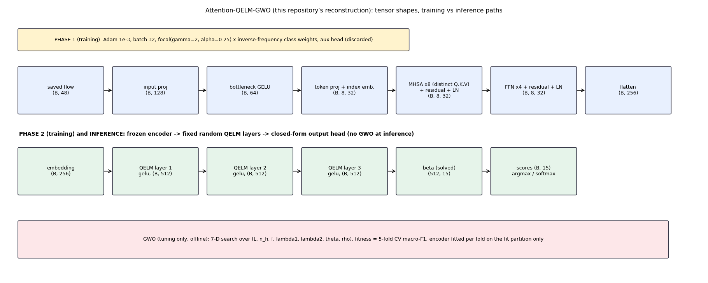

# Architecture

Original diagram generated by `iiot-qelm docs` from the code's shape contract (`src/iiot_qelm/evaluation/plots.py`), so it cannot drift. It is not a copy of the article's Figures 1-2.

How a saved flow moves through the classifier: **raw CSV row -> fitted preprocessor (48 floats in [0, 1]) -> encoder (256-d) -> frozen random QELM layers -> closed-form head -> 15 scores**. Training: Phase 1 trains the encoder with an auxiliary head; Phase 2 freezes it and solves the head. Inference runs the encoder and the QELM only; **GWO never runs at inference**.

## Tensor shapes (B = batch)

| Stage | Shape | Note |
|---|---|---|
| flow vector | (B, 48) | fixed feature order from the manifest |
| input projection | (B, 128) | `d_m = 128` |
| bottleneck + GELU | (B, 64) | `d_b = 64` |
| token projection | (B, 8, 32) | **reconstruction**, see below |
| + token-index embedding | (B, 8, 32) | learned, shape (8, 32), identical at inference |
| multi-head self-attention | (B, 8, 32) | 8 heads, per-head width 32, distinct Q/K/V, scale 1/sqrt(32), residual + LayerNorm |
| FFN (x4 expansion, GELU) | (B, 8, 32) | residual + LayerNorm, dropout 0.1 |
| flatten | (B, 256) | QELM input |
| QELM layers | (B, 512) x3 | fixed, seeded, GELU (published config) |
| output head | (512, K) solved | K = 2 or 15 |

## Reconstruction choices (the article does not resolve these)

| ID | Issue | Choice here |
|---|---|---|
| R-01 | A 64-vector cannot be reshaped to 8 x 32 | explicit learned `64 -> 256` token projection, reshaped to (8, 32) (upstream's reshape sits behind a config check that fails for its own defaults) |
| R-02 | the paper prints a 128-wide attention output beside a 32-wide residual | per-token output projection `256 -> 32` |
| R-03 | "feature-index embedding" | indexes the 8 **tokens** (derived from a learned projection), not the 48 raw fields |
| R-04 | Phase-1 supervision | auxiliary head `256 -> 128 -> K` (GELU, dropout 0.1), **discarded** before Phase 2; selected checkpoint = lowest validation loss (restore best); the 'w/o QELM' variants keep a 3-hidden-layer MLP head instead |
| R-05 | QELM weight scale / bias | He scale `sqrt(2/fan_in)`, bias `0.1 U(-1,1)` (upstream); flagged as not in the article |
| R-06 | global angle `theta` | added to every sampled angle (upstream). Because `phi ~ U(0, 2 pi)` is invariant to a constant shift modulo 2 pi, **theta changes which weights are drawn for a seed but not their distribution** (`theta_inertness`, tested). It is reported as inert |
| R-07 | `lambda1` "L1" | both lambdas multiply the identity (printed equation), so both are **ridge** terms and only their sum matters (tested). An identity penalty is not sparsity-inducing |
| R-08 | scores -> probabilities | softmax over the regression outputs (upstream); monotone, not calibrated. ROC/AUC use the continuous scores |
| R-09 | focal `alpha = 0.25` | `uniform` (rescales the loss; does not rebalance) by default; `binary` (Lin et al.) and `per_class` modes exist. Inverse-frequency class weights are a separate factor applied exactly once |
| R-10 | validation fraction | 10% of the outer training partition |
| R-11 | single `lambda = 1e-3` for 'w/o GWO' | mapped to `lambda1 = lambda2 = 5e-4` so the summed penalty equals 1e-3 |
| R-12 | ablation 'w/o multi-head attention' | the QELM consumes the raw 48 features; there is **no encoder to train, so focal loss has no gradient path** (the config is asserted by tests) |
| R-13 | 'w/o focal loss' | cross-entropy **with** the same inverse-frequency class weights |
| R-14 | hardware / framework | PyTorch on CPU; the article used TensorFlow 2.11 on an RTX 3080 |

## Losses and solver

* Focal loss is computed from `log_softmax` (never from clipped probabilities); `1 - p_t = -expm1(log p_t)`; extreme logits give finite loss and gradients (tested).
* QELM head: `(H^T H + (lambda1 + lambda2) I) beta = H^T T`, accumulated over batches in float64, Cholesky with a jitter ladder, then least squares as the last fallback. The solver used is recorded in the bundle.

## GWO

Search contract, decoding, stopping rule and evaluation accounting: [gwo-contract.md](gwo-contract.md) (generated). Fitness folds fit the encoder on the **fold's fit partition only**; embeddings are cached under a key containing fold, fit-index hash, seed and the full configuration.

## Bundles

`AttentionQELM.save` writes `phase1.pt` (state dict), `qelm.npz` (fixed random weights + solved head, `allow_pickle=False`), `history.json`, `manifest.json` (config, parameter counts, artifact id = SHA-256 prefix of the files). `torch.load(weights_only=True)` is used; still, load only bundles you trust.
